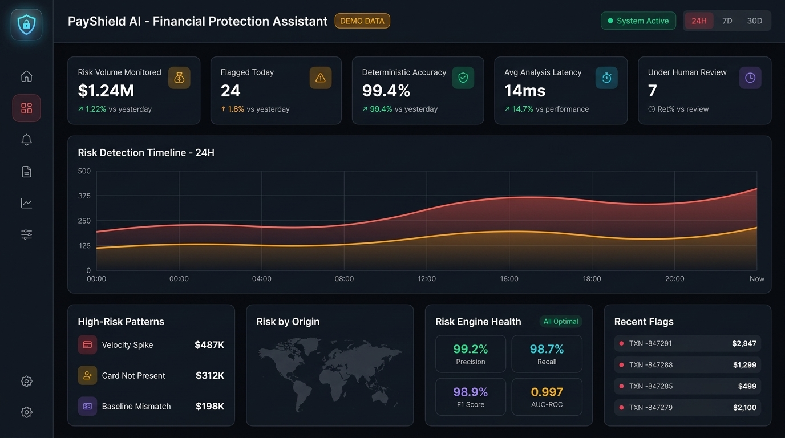
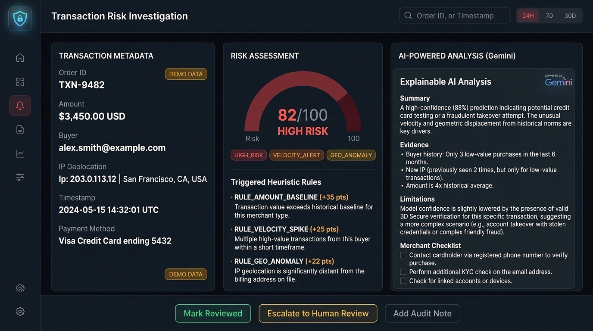
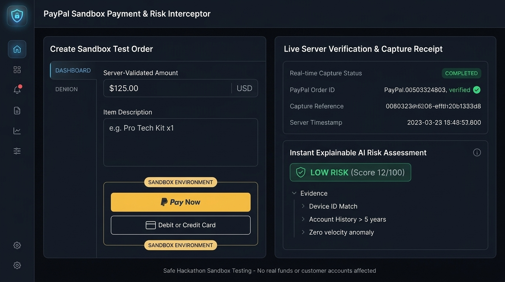
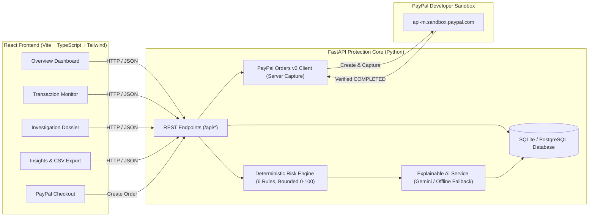

# 🛡️ PayShield AI — Explainable Financial Protection for PayPal Merchants

> **PayPal AI Hackathon Project**  
> An explainable AI-powered financial protection assistant for small businesses. PayShield AI continuously monitors payment transactions, evaluates risk using transparent deterministic rules, explains risk patterns with Google Gemini in plain English, and provides non-destructive merchant review tools.

---

## 🌐 Live Production Deployment
- **Live Web Application:** [https://payshield-ai-liard.vercel.app](https://payshield-ai-liard.vercel.app)
- **Direct Vercel Deployment:** [https://payshield-mkc980762-saikrishnakasarlla-1879.vercel.app](https://payshield-mkc980762-saikrishnakasarlla-1879.vercel.app)
- **GitHub Repository:** [https://github.com/saikrishnakasarla/payshield-ai](https://github.com/saikrishnakasarla/payshield-ai)
- **Backend API Health:** [https://payshield-ai-liard.vercel.app/api/health](https://payshield-ai-liard.vercel.app/api/health)

---

## 📚 Complete Project Documentation Index

For complete in-depth documentation, review the specialized guides in the [`docs/`](docs/) directory:

1. **[Project Overview & Blueprint (`docs/PROJECT_OVERVIEW.md`)](docs/PROJECT_OVERVIEW.md)**: Executive summary, student-friendly explanation, problem statement, proposed solution, and objectives.
2. **[Complete User Manual & Element Inventory (`docs/COMPLETE_USER_MANUAL.md`)](docs/COMPLETE_USER_MANUAL.md)**: Exhaustive inventory of every button, icon, form, filter, and page-by-page operational manual.
3. **[Technical Architecture & Data Flow (`docs/TECHNICAL_ARCHITECTURE.md`)](docs/TECHNICAL_ARCHITECTURE.md)**: Mermaid architecture diagrams, end-to-end payment capture sequences, database ER model, and feature-to-code mapping.
4. **[Functionality & QA Audit Report (`docs/FUNCTIONALITY_AUDIT.md`)](docs/FUNCTIONALITY_AUDIT.md)**: Static code review, runtime test matrix, what the project solves vs. current limitations, and test logs.
5. **[5-Minute Hackathon Demo Guide (`docs/HACKATHON_DEMO_GUIDE.md`)](docs/HACKATHON_DEMO_GUIDE.md)**: Concise presentation script with exact click sequence, sample inputs, and judge talking points.

---

## 🌟 Key Highlights & Honesty Disclaimers
- **Heuristic Recommendations, Not Proof of Fraud**: Risk scores (0–100) are heuristic approximations categorized into Low, Medium, and High tiers. PayShield AI clearly declares evidence and uncertainties.
- **Review-Only Merchant Operations**: PayShield AI records merchant audit decisions ("Mark Reviewed Safe", "Escalate for Human Review") with timestamps. It **never** blocks real customer accounts or cancels real payments automatically.
- **Server-Side Validation**: All PayPal order amounts and currencies are strictly validated server-side to prevent client tampering.
- **Deterministic + AI Synergy**: Numerical risk scoring is calculated by transparent Python heuristics. Google Gemini synthesizes evidence into plain English without inventing facts or overriding mathematical scores.
- **Secret Isolation**: All credentials (`PAYPAL_CLIENT_SECRET`, `GEMINI_API_KEY`, `SECRET_KEY`) remain strictly on the backend in environment variables.

---

## 🎨 User Interface & Concept Mockups

The interface features a dark cyber-fintech command-center design (`#0B0E14` slate background, coral-red & amber neon accents, emerald active indicators, and Lucide iconography).



### Key Views:
1. **Overview Dashboard**: High-level telemetry, Recharts detection timeline curves, risk pattern progress bars, model health statistics, and geographic origin tracking.
2. **Transaction Monitor**: Sortable, searchable transaction ledger with Low/Medium/High risk filters, review status filters, pagination, and synthetic demo indicators.
3. **Transaction Investigation Dossier**: Complete transaction details, circular SVG risk gauge, triggered rule breakdown with exact score contributions, Google Gemini explainable narrative, and merchant verification checklist.
   
   

4. **PayPal Sandbox Interceptor**: Interactive checkout with PayPal Smart Buttons, server-side capture verification, and immediate AI risk scoring.

   

5. **Insights & Reports**: Chargeback defense readiness scoring, top triggered heuristic rules, and one-click CSV ledger export.
6. **Settings & Rules Configuration**: Configurable risk weights, sandbox connection status inspection, and one-click demo database reset.

---

## 🏗️ System Architecture



---

## 🛠️ Technology Stack

| Layer | Technologies | Purpose |
| :--- | :--- | :--- |
| **Frontend** | React 18, Vite, TypeScript, Tailwind CSS, Framer Motion, Recharts, Lucide React, React Router 6 | Cyber-fintech dashboard, spline charts, and responsive UI |
| **Backend** | Python 3.11+, FastAPI, Pydantic v2, SQLAlchemy, Uvicorn | High-performance asynchronous API, schema validation, and persistence |
| **Deterministic Engine** | Pure Python Heuristic Evaluator | Bounded (0–100) scoring across 6 documented rules |
| **Explainable AI** | Google Gemini 1.5 Flash (with structured fallback) | Plain-English evidence synthesis, uncertainty analysis, and checklists |
| **Payments** | PayPal REST Orders API (Sandbox v2) & `@paypal/react-paypal-js` | Server-side order creation, buyer approval flow, and capture verification |
| **Database** | SQLite (development / Vercel `/tmp`) / PostgreSQL | Seeded with 32 reproducible synthetic demo transactions |
| **Testing** | Pytest, Pytest-Asyncio, HTTPX | Comprehensive 28-test unit and integration test suite |
| **Deployment** | Vercel Multi-Service Project (`vercel.json`) | Unified frontend and serverless ASGI backend routing |

---

## 🚀 Quickstart Guide

### 1. Prerequisites
- Python 3.11+
- Node.js 18+ and npm

### 2. Backend Setup
```bash
cd backend

# Create and activate virtual environment
python -m venv venv

# Windows
.\venv\Scripts\activate
# Linux/macOS
source venv/bin/activate

# Install dependencies
pip install -r requirements.txt

# Run backend test suite (28 passed tests)
pytest -v

# Start FastAPI server on port 8000
python -m uvicorn app.main:app --reload --port 8000
```
*Backend runs at `http://127.0.0.1:8000`. Interactive OpenAPI documentation available at `http://127.0.0.1:8000/docs`.*

### 3. Frontend Setup
In a new terminal:
```bash
cd frontend

# Install packages
npm install

# Build production bundle check
npm run build

# Start Vite dev server on port 5173
npm run dev
```
*Frontend opens at `http://localhost:5173` with automatic proxying of `/api` requests to `http://127.0.0.1:8000`.*

---

## ⚙️ Environment Variables (`.env`)

Copy `.env.example` to `backend/.env` or configure in Vercel:
```env
APP_ENV="development"
DEBUG=true
SECRET_KEY="payshield-hackathon-super-secret-jwt-key-2026-secure-random"

# Optional: Google Gemini API for live LLM explanations
# (Leave empty to use the built-in deterministic rule explainer)
GEMINI_API_KEY=""
GEMINI_MODEL="gemini-1.5-flash"

# Optional: PayPal Sandbox credentials
# (Leave empty to use the built-in Sandbox Simulator mode)
PAYPAL_MODE="sandbox"
PAYPAL_CLIENT_ID=""
PAYPAL_CLIENT_SECRET=""
PAYPAL_BASE_URL="https://api-m.sandbox.paypal.com"
PAYPAL_MOCK_SIMULATOR=False

# Configurable Risk Engine Thresholds
BASELINE_AMOUNT_MULTIPLIER=3.0
VELOCITY_WINDOW_MINUTES=10
MEDIUM_RISK_SCORE=35
HIGH_RISK_SCORE=70
```

---

## 🧪 Testing Suite

PayShield AI includes **28 automated unit and integration tests** covering risk scoring, rule triggers, amount validation, rate limiting, and API routes:

```bash
cd backend
.\venv\Scripts\pytest -v
```

**Test Coverage Highlights**:
- ✅ `test_baseline_amount_rule_triggers`: Detects amounts exceeding customer baseline multiplier.
- ✅ `test_velocity_spike_rule_triggers`: Identifies rapid successive transactions within 10 minutes.
- ✅ `test_order_item_mismatch_rule`: Flags discrepancies between item sum and total charged.
- ✅ `test_geo_ip_anomaly_rule`: Detects foreign connection vs billing country mismatches.
- ✅ `test_risk_score_is_bounded_zero_to_hundred`: Verifies invariant score bounds.
- ✅ `test_paypal_create_order_zero_amount_rejected`: Enforces positive order amounts server-side.
- ✅ `test_capture_unknown_order_returns_404`: Rejects unregistered order captures with 404.
- ✅ `test_capture_amount_or_currency_mismatch_rejected`: Rejects amount/currency deviations on capture.
- ✅ `test_paypal_webhook_listener`: Verifies cryptographic PayPal transmission signatures.
- ✅ `test_rate_limiting_auth_endpoint`: Enforces sliding-window rate limits (HTTP 429).
- ✅ `test_cross_user_data_isolation`: Enforces per-user order data privacy (HTTP 403).
- ✅ `test_ai_fallback_generates_valid_structure`: Ensures zero downtime even when AI is unconfigured.

---

## 📄 License & Disclaimer
This project is licensed under the [MIT License](LICENSE).  
*PayShield AI is a prototype designed for the PayPal AI Hackathon. It evaluates probabilistic risk indicators and provides decision support; it does not replace certified AML/KYC banking verification.*
