# PayShield AI — Comprehensive System Architecture & Engineering Design

**Auditor / Architect:** Senior FinTech Systems Architect & Product Manager  
**Version:** 2.0 (PayPal AI Hackathon Final Delivery)  
**Specification:** End-to-End Payment Lifecycle, Risk Screening & Audit Governance  

---

## 1. High-Level Architectural Diagram

The Mermaid diagram below defines the complete component hierarchy and end-to-end data flow:

```mermaid
flowchart TB
    Merchant["Merchant / Risk Analyst"]

    subgraph ClientLayer ["Frontend Client Layer (React 18 + TypeScript + Vite)"]
        Dashboard["Merchant Overview Dashboard"]
        Monitor["Transaction Monitor & Filter"]
        InvestigationModal["Investigation Dossier Modal"]
        CheckoutView["PayPal Sandbox & Multi-Gateway UI"]
        AuditView["Cryptographic Audit & Reports UI"]
    end

    subgraph APILayer ["Backend API & Gateway Layer (FastAPI / ASGI)"]
        AuthMiddleware["Authentication & Rate Limiter (JWT, Tenant Isolation)"]
        Router["FastAPI Application Router (/api/*)"]
        WebhookHandler["PayPal Webhook Ingestion (/api/paypal/webhook)"]
        SigVerifier["Transmission Signature & Replay Verifier"]
        ReconciliationWorker["Asynchronous Reconciliation & Health Check"]
    end

    subgraph PaymentGateways ["Payment Execution Layer"]
        subgraph RealPayPal ["Official PayPal Developer Sandbox"]
            PP_OrdersAPI["PayPal Orders v2 API\n(api-m.sandbox.paypal.com)"]
            PP_BuyerModal["PayPal SDK Smart Buttons\n(Buyer Approval Modal)"]
            PP_CaptureAPI["PayPal Server Capture API\n(Independent Capture)"]
        end

        subgraph MockSimulatorPath ["Offline Gateway Simulator (Clearly Identified Fallback)"]
            SimEngine["Deterministic Payment Simulator\n(Watermarked: is_synthetic=true)"]
            SimReceipt["Synthetic Capture Receipt\n(CAP-SANDBOX-VERIFIED)"]
        end
    end

    subgraph IntelligenceCore ["PayShield Risk Intelligence Core"]
        RiskEngine["Deterministic Rule Engine\n(6 Rules: Velocity, Spike, Geo, Structuring)"]
        MLClassifier["Random Forest ML Classifier\n(P(Fraud) Prediction)"]
        EnsembleBlender["Hybrid Ensemble Blender\n(0.5 * Rules + 0.5 * ML)"]
        
        subgraph ExplainabilityModule ["AI Explainability Engine"]
            GeminiLLM["Google Gemini 1.5 Flash\n(Grounded Evidence Synthesis)"]
            DeterministicFallback["Deterministic Forensic Fallback\n(Zero-Hallucination Safe Mode)"]
        end
    end

    subgraph StorageLayer ["Persistence & Governance Layer (SQLAlchemy 2.0 / Alembic)"]
        DB[(Relational Database\nPostgreSQL Prod / SQLite Dev)]
        AuditLogger["Cryptographic Audit Trail Engine\n(RFC 6962 SHA-256 + HMAC-SHA256)"]
    end

    Merchant -->|Interacts via Browser| ClientLayer
    ClientLayer -->|HTTPS + Bearer JWT| AuthMiddleware
    AuthMiddleware --> Router

    CheckoutView -->|1. Create Order Request| Router
    Router -->|If Credentials Present| PP_OrdersAPI
    Router -.->|If Missing/Mock Keys| SimEngine

    PP_OrdersAPI -->|2. Order Token| PP_BuyerModal
    PP_BuyerModal -->|3. Buyer Approves| CheckoutView
    CheckoutView -->|4. Capture Order Request| Router
    Router -->|5. Independent Capture| PP_CaptureAPI
    PP_CaptureAPI -->|6. Verified COMPLETED| Router

    SimEngine -->|Synthetic Approval| SimReceipt
    SimReceipt -->|Synthetic Capture| Router

    PP_CaptureAPI -.->|Async Webhook Event| WebhookHandler
    WebhookHandler --> SigVerifier
    SigVerifier -->|Idempotent Event Check| Router

    Router -->|Captured Order Payload| RiskEngine
    RiskEngine -->|Extracted Vectors| MLClassifier
    RiskEngine & MLClassifier --> EnsembleBlender
    EnsembleBlender --> ExplainabilityModule
    ExplainabilityModule --> GeminiLLM
    GeminiLLM -.->|Offline / No API Key| DeterministicFallback

    Router --> DB
    EnsembleBlender --> DB
    ExplainabilityModule --> DB
    SigVerifier --> ReconciliationWorker
    ReconciliationWorker --> DB

    Router --> AuditLogger
    AuditLogger -->|Chained Hash Pointer| DB

    DB -->|Aggregated Telemetry & Dossier| Router
    Router --> Dashboard
    Router --> Monitor
    Router --> InvestigationModal
    Router --> AuditView
```

---

## 2. Core Architectural Components

### 2.1 Client Layer (Frontend)
- **Framework:** React 18 with TypeScript 5.6 and Vite.
- **Styling:** Custom FinTech SaaS Design System (`slate-50` background, pure white cards, corporate navy and royal blue accents).
- **Navigation:** Deep navy desktop sidebar and responsive 44px touch-target mobile drawer.
- **Key Modules:**
  - `OverviewDashboard`: High-level metrics, Recharts area trends, geographic distribution.
  - `TransactionMonitor`: Searchable, sortable transaction table with mobile card collapsing.
  - `TransactionInvestigationModal`: Forensic dossier displaying score gauge, rule breakdowns, SHAP attribution bars, and merchant review actions.
  - `PayPalSandboxCheckout`: Interactive checkout with PayPal Smart Buttons and instant capture verification.
  - `UnifiedCheckoutPage`: Multi-gateway harness (PayPal, Stripe, Razorpay, Adyen).
  - `InsightsReports`: Operational insights, public benchmark comparisons, and interactive cryptographic audit proof.

### 2.2 Backend Gateway & Middleware Layer (FastAPI)
- **ASGI Framework:** FastAPI running on Uvicorn.
- **Authentication:** OAuth2 password bearer with high-entropy JWT tokens and bcrypt password hashing.
- **Multi-Tenant Scoping:** Injects `current_user` and enforces tenant isolation at query boundaries.
- **Rate Limiting:** Sliding-window limiter on sensitive endpoints (`/api/auth/*`, `/api/paypal/*`).
- **Security Headers:** Injects `X-Content-Type-Options: nosniff`, `X-Frame-Options: DENY`, `Strict-Transport-Security`, and request correlation IDs (`X-Request-ID`).

### 2.3 Payment Execution Layer
- **Live PayPal Orders v2 Client (`app/services/paypal_service.py`):**
  - Connects to `https://api-m.sandbox.paypal.com`.
  - Asynchronously requests OAuth 2.0 bearer tokens with expiration caching.
  - Issues order creation with server-validated currency, unit amounts, and return URLs.
  - Issues independent server-side capture upon buyer approval.
- **Offline Gateway Simulator (Clearly Identified Path):**
  - Activated when `PAYPAL_CLIENT_ID` or `PAYPAL_CLIENT_SECRET` are unconfigured.
  - Explicitly watermarks transactions as synthetic (`is_synthetic: true`).
  - Generates reproducible, deterministic capture responses so evaluators can test without external credentials.
- **Webhook Processing & Reconciliation:**
  - Listens at `/api/paypal/webhook` for `PAYMENT.CAPTURE.COMPLETED`.
  - Validates transmission signatures using PayPal certificate headers (`PAYPAL-AUTH-ALGO`, `PAYPAL-CERT-URL`, `PAYPAL-TRANSMISSION-SIG`).
  - Enforces idempotency via `processed_webhook_events` table to prevent duplicate transaction recording.
  - Background reconciliation worker periodically correlates pending database orders with PayPal server capture statuses.

### 2.4 Risk Intelligence Core
- **Deterministic Heuristic Rules:**
  - Evaluates 6 core rules: Velocity Spike, Baseline Surge, Geo-IP Anomaly, Structuring Evasion, High-Frequency Burst, Cart Mismatch.
  - Guaranteed mathematical bound: strictly clamped between 0 and 100.
- **Machine Learning Classification:**
  - Pre-trained Random Forest model (`model.pkl`) evaluates non-linear multi-signal risk vectors.
  - Computes fraud probability $P(\text{Fraud})$ reflecting realistic ~0.2% fraud class imbalance.
- **Hybrid Ensemble Blender:**
  - Blends heuristic score (50%) and ML probability (50%):
    $$\text{Hybrid Score} = 0.5 \times \text{RuleScore} + 0.5 \times (P(\text{Fraud}) \times 100)$$
- **Explainable AI Module:**
  - **Google Gemini 1.5 Flash:** Formats complex indicators into plain-English narratives, highlighted risk factors, and actionable merchant checklists.
  - **Deterministic Grounding Constraint:** System prompt restricts Gemini to cite only verified telemetry extracted from the database.
  - **Deterministic Fallback Engine:** If Gemini API is unreachable or keys are unconfigured, a deterministic rule synthesizer generates structured explanations with 100% availability.

### 2.5 Storage & Governance Layer
- **SQLAlchemy 2.0 Declarative Models:**
  - `users`, `merchants`, `transactions`, `paypal_orders`, `risk_analyses`, `audit_logs`.
- **Alembic Version-Controlled Migrations:**
  - Managed declarative schema evolution under `backend/alembic`.
- **Cryptographic Audit Trail Engine:**
  - Every transaction event computes:
    $$\text{Hash}_n = \text{SHA-256}(\text{RecordPayload} \parallel \text{Hash}_{n-1} \parallel \text{Timestamp})$$
  - Signs hashes using merchant HMAC-SHA256 secret.
  - Provides mathematical proof of forward and backward tamper resistance.
