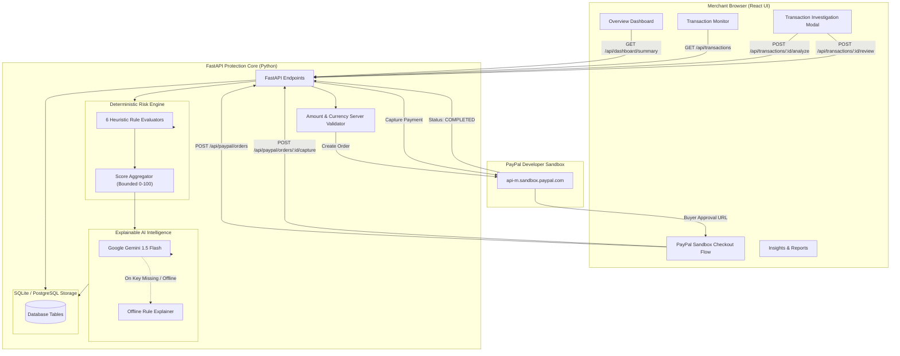

# PayShield AI — Architecture & Technical Design

## Overview
**PayShield AI** is an explainable AI-powered financial protection assistant built specifically for small businesses using PayPal. It bridges deterministic risk scoring with Google Gemini conversational intelligence to provide merchants with transparent, verifiable fraud risk recommendations.

## Core Security & Honesty Safeguards
1. **Never Assume Fraud**: The engine scores transactions into Low, Medium, and High risk tiers with explicit evidence and confidence limitations.
2. **Review-Only Actions**: Merchandising actions ("Mark Reviewed Safe", "Escalate to Human Review") record database audit logs without destructive bank blocking.
3. **Server-Side Payment Validation**: Transaction amounts and currencies are enforced by FastAPI before transmitting orders to PayPal's Orders API.
4. **Secret Isolation**: Secrets (`GEMINI_API_KEY`, `PAYPAL_CLIENT_SECRET`) reside exclusively in backend environment variables.
5. **Deterministic Foundation**: AI text explains the evidence produced by the deterministic engine; it cannot alter payment totals or override scores.
