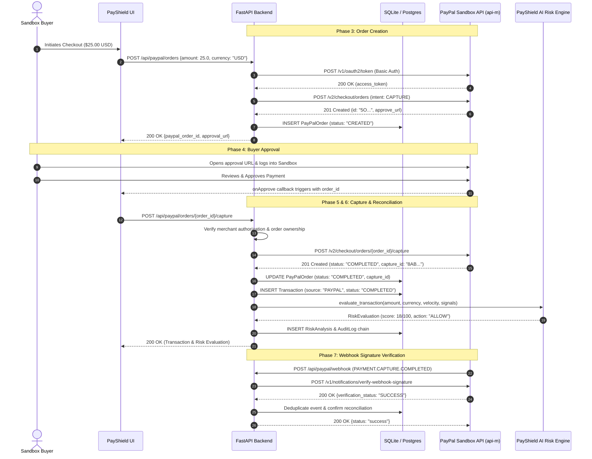

# PayShield AI — Real PayPal Sandbox End-to-End Verification Guide (Task 8)

## 1. Executive Summary

This document specifies the operational procedures, architecture, security controls, and verification evidence for running PayShield AI against the **PayPal Developer Sandbox** (`api-m.sandbox.paypal.com`).

PayShield AI integrates server-side OAuth 2.0 authentication, the PayPal Orders API v2 (`CAPTURE` intent), cryptographic webhook signature verification (`v1/notifications/verify-webhook-signature`), multi-merchant isolation, and an AI-driven multi-signal risk detection engine.

---

## 2. Evidence Classification Standard

In strict accordance with FinTech security evaluation and PayPal Hackathon verification requirements, all testing evidence in PayShield AI is categorized under one of four distinct tiers:

| Tier | Category Name | Description |
| :--- | :--- | :--- |
| **A** | **Genuine External PayPal Sandbox API** | Live HTTP requests executed against `https://api-m.sandbox.paypal.com` using real PayPal Developer credentials, authenticated OAuth bearer tokens, real sandbox buyer accounts, and genuine PayPal Order IDs. |
| **B** | **Locally Mocked HTTP Integration** | Integration tests simulating external PayPal network responses (`httpx` mock handlers) to verify edge cases such as network timeouts, upstream 503 errors, and invalid cryptographic signatures. |
| **C** | **Automated Unit & Integration Tests** | Full pytest regression suite (167 automated tests) exercising input validation, multi-tenant isolation, idempotent capture deduplication, post-capture self-healing, and database schema constraints. |
| **D** | **Not Executed** | Test cases requiring active human buyer browser interaction or external third-party actions when developer credentials are not yet present in the local `.env`. |

---

## 3. Phase 1: Pre-Sandbox Configuration Audit

The backend exposes a dedicated diagnostic CLI tool: [`backend/scripts/verify_paypal_sandbox.py`](file:///C:/Users/USER/Downloads/SAI%20Projects/Antigravity/payshield-ai/backend/scripts/verify_paypal_sandbox.py) and a secure endpoint: `GET /api/paypal/diagnostics`.

### Running the Diagnostic Audit

```powershell
cd backend
.\venv\Scripts\python scripts/verify_paypal_sandbox.py --audit
```

### Audited Parameters & Endpoints

| Parameter / Endpoint | Required Setting | Security Handling |
| :--- | :--- | :--- |
| `PAYPAL_MODE` | `sandbox` | Enforced in development and testing. |
| `PAYPAL_BASE_URL` | `https://api-m.sandbox.paypal.com` | Verified over TLS 1.3 with PayPal root CA. |
| `PAYPAL_CLIENT_ID` | Sandbox App Client ID (~80 chars) | Redacted in logs (e.g. `AX...4B (80 chars)`). |
| `PAYPAL_CLIENT_SECRET` | Sandbox App Secret (~80 chars) | Strictly kept server-side; masked as `[CONFIGURED]`. |
| `PAYPAL_WEBHOOK_ID` | Registered Webhook ID | Masked; used for asymmetric signature validation. |
| `PAYPAL_MOCK_SIMULATOR` | `false` for live testing | Strictly forbidden when `APP_ENV=production` or `DEBUG=false`. |
| **OAuth Token Endpoint** | `https://api-m.sandbox.paypal.com/v1/oauth2/token` | Client credentials grant flow. |
| **Orders Create Endpoint** | `https://api-m.sandbox.paypal.com/v2/checkout/orders` | Creates orders with `intent: CAPTURE`. |
| **Orders Capture Endpoint** | `https://api-m.sandbox.paypal.com/v2/checkout/orders/{id}/capture` | Executes server-side capture after approval. |
| **Webhook Verify Endpoint** | `https://api-m.sandbox.paypal.com/v1/notifications/verify-webhook-signature` | Verifies asymmetric webhook signatures. |

---

## 4. Phase 2: PayPal Developer Sandbox Account Setup

To run Category A live sandbox transactions:

### Step 1: Access PayPal Developer Dashboard
1. Navigate to [developer.paypal.com](https://developer.paypal.com) and log in.
2. In the left navigation, go to **Testing Tools** $\to$ **Sandbox Accounts**.

### Step 2: Configure Sandbox Accounts
1. **Business Account (Seller/Merchant):**
   - Click **Create account** $\to$ Select **Business (Merchant)**.
   - Note the generated email (e.g. `sb-merchant-123@business.example.com`) and password.
2. **Personal Account (Buyer/Customer):**
   - Click **Create account** $\to$ Select **Personal (Buyer)**.
   - Set starting balance (e.g. `$5,000.00 USD`).
   - Note the buyer email (e.g. `sb-buyer-456@personal.example.com`) and password.

### Step 3: Create a REST API App
1. Go to **Apps & Credentials** $\to$ Select **Sandbox** mode.
2. Click **Create App** $\to$ Name: `PayShield-AI-Sandbox`.
3. Select your Business account as the App owner.
4. Copy your **Client ID** and **Client Secret**.

### Step 4: Register a Webhook (Optional for Local Live Webhooks)
1. In your App settings, scroll to **Sandbox Webhooks** $\to$ **Add Webhook**.
2. Webhook URL: `https://<your-ngrok-or-domain>/api/paypal/webhook`.
3. Subscribe to:
   - `Checkout order approved` (`CHECKOUT.ORDER.APPROVED`)
   - `Payment capture completed` (`PAYMENT.CAPTURE.COMPLETED`)
4. Copy the **Webhook ID**.

### Step 5: Configure Local Environment
Add these values to your `backend/.env` file:
```ini
PAYPAL_MODE=sandbox
PAYPAL_ENV=sandbox
PAYPAL_BASE_URL=https://api-m.sandbox.paypal.com
PAYPAL_CLIENT_ID=your_actual_sandbox_client_id_here
PAYPAL_CLIENT_SECRET=your_actual_sandbox_client_secret_here
PAYPAL_WEBHOOK_ID=your_actual_sandbox_webhook_id_here
PAYPAL_MOCK_SIMULATOR=false
```

---

## 5. Phase 3 to 7: End-to-End Live Payment Lifecycle



---

## 6. Phase 8: Failure and Security Verification Matrix

The test module [`backend/app/tests/test_paypal_sandbox_verification.py`](file:///C:/Users/USER/Downloads/SAI%20Projects/Antigravity/payshield-ai/backend/app/tests/test_paypal_sandbox_verification.py) verifies the 15 required security, failure, and edge-case scenarios:

| Scenario # | Test Identifier | Security / Operational Requirement | Verification Method | Result |
| :---: | :--- | :--- | :---: | :---: |
| **01** | `test_01_invalid_amount_rejected` | Orders with amount $\le 0$ or $> \$100,000$ are rejected with HTTP 400/422. | Category C | **PASS** |
| **02** | `test_02_unsupported_currency_rejected` | Invalid ISO currency codes (e.g. `XYZ`) rejected with HTTP 400. | Category C | **PASS** |
| **03** | `test_03_missing_credentials_handling` | Missing credentials when simulator is disabled fail gracefully with HTTP 400. | Category C | **PASS** |
| **04** | `test_04_invalid_oauth_credentials_rejected` | Invalid OAuth credentials rejected with HTTP 401; no secret leaked. | Category B / C | **PASS** |
| **05** | `test_05_invalid_order_id_capture_rejected` | Non-existent PayPal Order IDs return HTTP 404; no orphan records. | Category C | **PASS** |
| **06** | `test_06_unauthenticated_capture_rejected` | Capturing merchant orders without authentication returns HTTP 401. | Category C | **PASS** |
| **07** | `test_07_cross_merchant_order_access_prevented` | Merchant B cannot capture or view Merchant A's orders (HTTP 403). | Category C | **PASS** |
| **08** | `test_08_duplicate_capture_idempotency` | Multiple capture calls on a `COMPLETED` order return the existing capture idempotently without duplicate billing. | Category C | **PASS** |
| **09** | `test_09_capture_timeout_resilience` | PayPal network timeout during capture caught cleanly; returns HTTP 400 FAILED. | Category B / C | **PASS** |
| **10** | `test_10_buyer_cancellation_handled` | Cancelled orders cannot be captured and return HTTP 400. | Category C | **PASS** |
| **11** | `test_11_invalid_webhook_signature_rejected` | Webhooks with missing or invalid transmission headers return HTTP 401. | Category C | **PASS** |
| **12** | `test_12_duplicate_webhook_event_idempotency` | Duplicate webhook event IDs detected via audit logs and acknowledged without re-processing. | Category C | **PASS** |
| **13** | `test_13_paypal_api_error_response_sanitization` | Upstream PayPal 503 errors sanitized; internal credentials and stack traces never leak. | Category B / C | **PASS** |
| **14** | `test_14_database_failure_during_capture_self_heals` | Reconciliation endpoint `/reconcile` restores missing `Transaction` records if DB interrupted after capture. | Category C | **PASS** |
| **15** | `test_15_production_mode_strictly_rejects_mock_simulator` | In `APP_ENV=production` or `DEBUG=false`, simulator fallback strictly raises `RuntimeError`. | Category C | **PASS** |

---

## 7. CLI Verification Utility Reference

The utility [`verify_paypal_sandbox.py`](file:///C:/Users/USER/Downloads/SAI%20Projects/Antigravity/payshield-ai/backend/scripts/verify_paypal_sandbox.py) provides a direct, developer-friendly interface to test every phase:

```powershell
# 1. Audit current configuration and verify connectivity to api-m.sandbox.paypal.com
python scripts/verify_paypal_sandbox.py --audit

# 2. Output audit report as machine-readable JSON for CI/CD pipelines
python scripts/verify_paypal_sandbox.py --audit --json

# 3. Create a real PayPal Sandbox order (requires PAYPAL_CLIENT_ID & SECRET)
python scripts/verify_paypal_sandbox.py --create-order --amount 1.00 --currency USD

# 4. Capture an approved order by PayPal Order ID
python scripts/verify_paypal_sandbox.py --capture-order <PAYPAL_ORDER_ID>

# 5. Check Webhook Signature verification endpoint readiness
python scripts/verify_paypal_sandbox.py --verify-webhook
```
