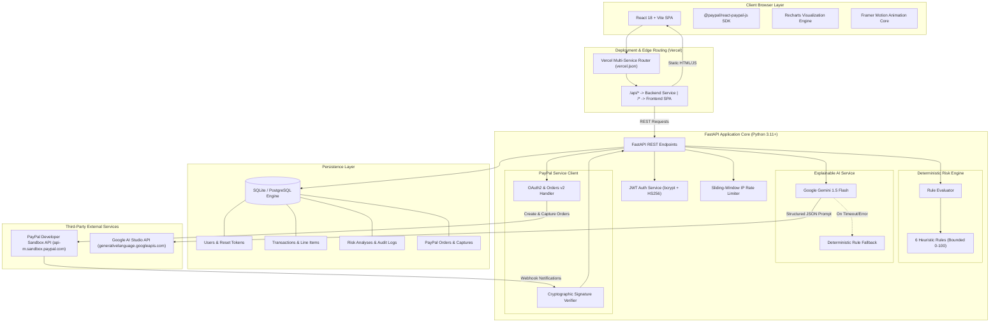
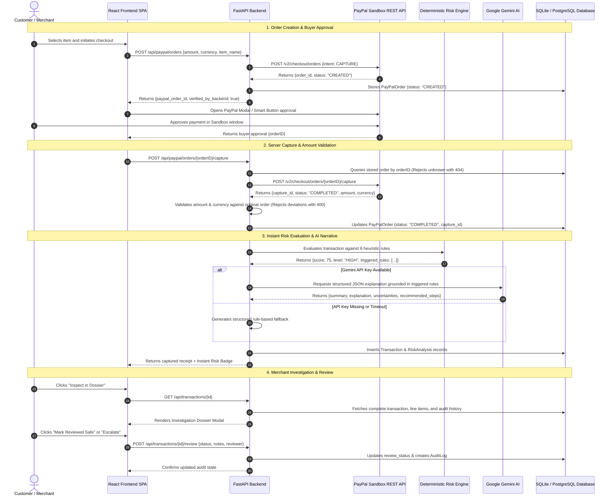
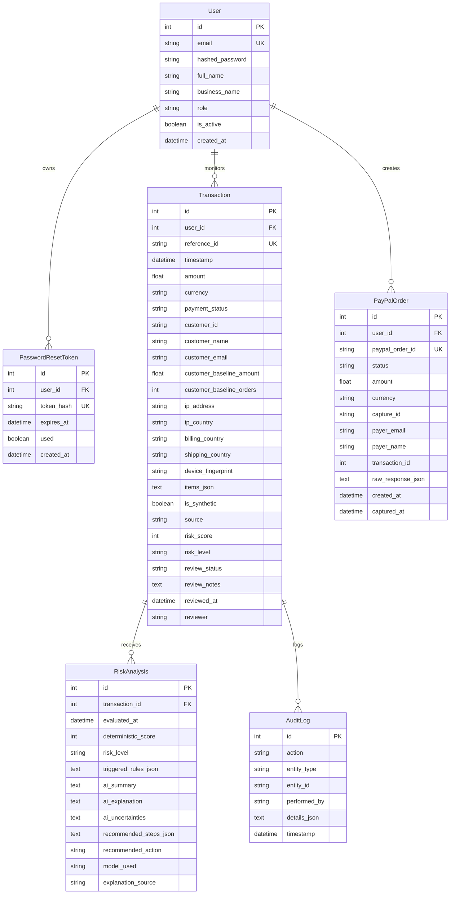

# 🏗️ PayShield AI — Technical Architecture & System Design

This document details the architectural blueprints, communication flows, database relationships, and component mapping for the **PayShield AI** platform.

---

## 1. High-Level System Architecture

---

## 2. End-to-End Payment & Screening Sequence Diagram

---

## 3. Database Entity Relationship (ER) Model

---

## 4. API Endpoint Reference

| Method | Endpoint | Description | Auth Requirement | Rate Limit |
| :--- | :--- | :--- | :--- | :--- |
| `GET` | `/api/health` | Service health status, database connection, PayPal/AI config mode | Public | None |
| `POST` | `/api/auth/register` | Register merchant user, hashes password with bcrypt, returns JWT | Public | 15 req/min |
| `POST` | `/api/auth/login` | Verify credentials, issues JWT and HttpOnly cookie | Public | 15 req/min |
| `GET` | `/api/auth/me` | Fetch authenticated user profile | Authenticated | None |
| `POST` | `/api/auth/forgot-password`| Invalidate old tokens, issue 1-hour reset token | Public | 5 req/5min |
| `POST` | `/api/auth/reset-password` | Validate token hash, update user password | Public | 5 req/5min |
| `GET` | `/api/dashboard/summary` | Telemetry metrics, Recharts timeline, fraud patterns, high-risk origins | Public / Scoped | None |
| `GET` | `/api/transactions` | Paginated transaction ledger with search, tier, and review filters | Public / Scoped | None |
| `GET` | `/api/transactions/{id}` | Detailed transaction metadata, line items, and risk analysis dossier | Public / Scoped | None |
| `POST` | `/api/transactions/{id}/review` | Update review status (`REVIEWED_SAFE`, `ESCALATED`), append audit note | Public / Auth | None |
| `POST` | `/api/transactions/{id}/analyze`| Re-run Gemini AI narrative synthesis for specific transaction | Public / Auth | None |
| `GET` | `/api/paypal/status` | Current PayPal configuration status and simulator flag | Public | None |
| `GET` | `/api/paypal/config` | Client ID and environment target for frontend JS SDK | Public | None |
| `POST` | `/api/paypal/orders` | Create PayPal Sandbox order (intent: CAPTURE) | Public / Auth | None |
| `POST` | `/api/paypal/orders/{id}/capture` | Capture order, validate amount/currency, execute risk screening | Public / Auth | None |
| `GET` | `/api/paypal/orders/{id}` | Inspect order capture details (enforces user ownership) | Authenticated | None |
| `POST` | `/api/paypal/webhook` | Receive & cryptographically verify PayPal Sandbox webhooks | PayPal HMAC | None |
| `GET` | `/api/insights` | Chargeback defense readiness, monitored volume, top triggered rules | Public | None |
| `GET` | `/api/insights/export-csv` | Download complete transaction ledger as CSV | Public | None |
| `GET` | `/api/settings` | Current heuristic thresholds and service integration readiness | Public | None |
| `POST` | `/api/settings/thresholds`| Update heuristic multipliers, windows, and risk floor scores | Authenticated | None |
| `POST` | `/api/demo/reset` | Restore SQLite database to 32 reproducible synthetic demo orders | Authenticated | None |

---

## 5. Feature-to-Code Mapping

| Feature / Capability | Frontend Implementation | Backend Implementation | Database Model |
| :--- | :--- | :--- | :--- |
| **Overview Dashboard** | `frontend/src/pages/OverviewDashboard.tsx` | `backend/app/api/routes_dashboard.py` | `Transaction`, `RiskAnalysis` |
| **Transaction Monitor & Filters** | `frontend/src/features/transactions/` | `backend/app/api/routes_transactions.py` | `Transaction` |
| **Investigation Dossier Modal** | `frontend/src/features/transactions/TransactionInvestigationModal.tsx` | `backend/app/api/routes_transactions.py` (`get_transaction`) | `Transaction`, `RiskAnalysis` |
| **Deterministic Risk Engine** | `frontend/src/features/risk/RiskScoreGauge.tsx` | `backend/app/risk_engine/engine.py` & `rules.py` | In-memory evaluation |
| **Google Gemini AI Explainer** | `frontend/src/features/risk/AIExplanationCard.tsx` | `backend/app/services/ai_explainer.py` | `RiskAnalysis` |
| **PayPal Sandbox Checkout** | `frontend/src/features/payments/PayPalSandboxCheckout.tsx` | `backend/app/api/routes_paypal.py` & `paypal_service.py` | `PayPalOrder`, `Transaction` |
| **PayPal Webhook Verification** | None (Direct HTTP listener) | `backend/app/services/paypal_service.py` (`verify_webhook_signature`) | `AuditLog` |
| **Insights & CSV Export** | `frontend/src/pages/InsightsReports.tsx` | `backend/app/api/routes_insights.py` | `Transaction`, `RiskAnalysis` |
| **Authentication & Tokens** | `frontend/src/pages/auth/` & `auth-context.tsx`| `backend/app/api/routes_auth.py` & `auth.py` | `User`, `PasswordResetToken` |
| **Rate Limiting** | None (Receives HTTP 429) | `backend/app/services/rate_limiter.py` | In-memory sliding window |
| **Settings & Demo Re-seed** | `frontend/src/pages/SettingsDocs.tsx` | `backend/app/api/routes_settings.py` & `routes_dashboard.py` | `Transaction`, `RiskAnalysis` |
